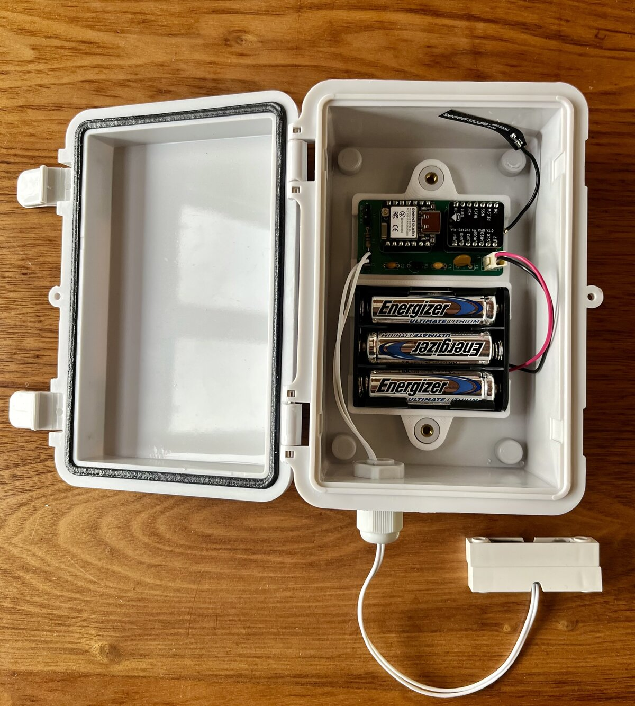
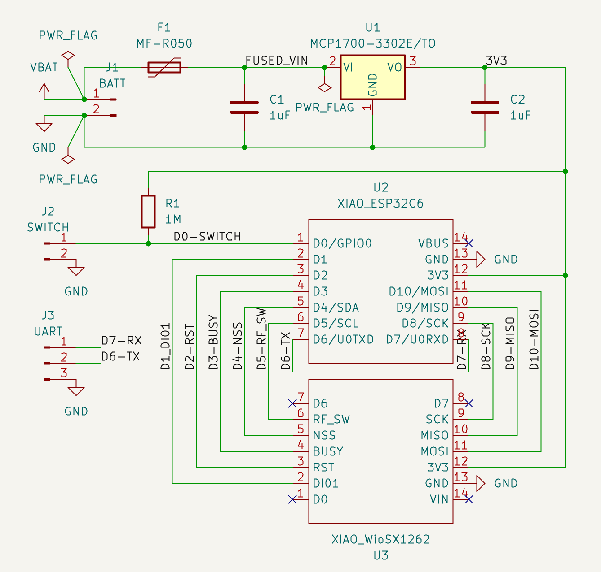
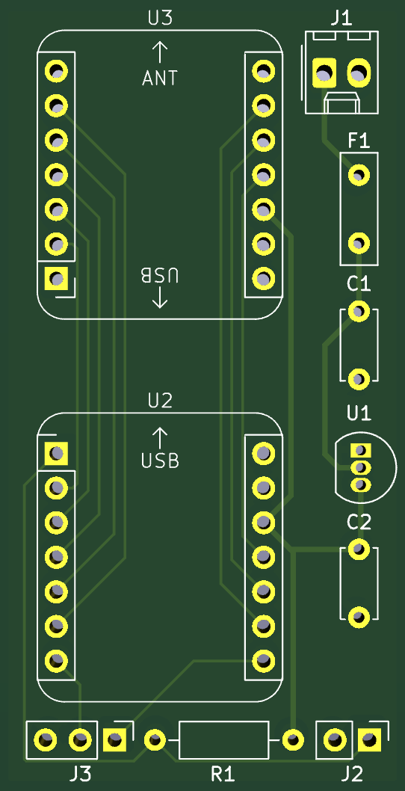
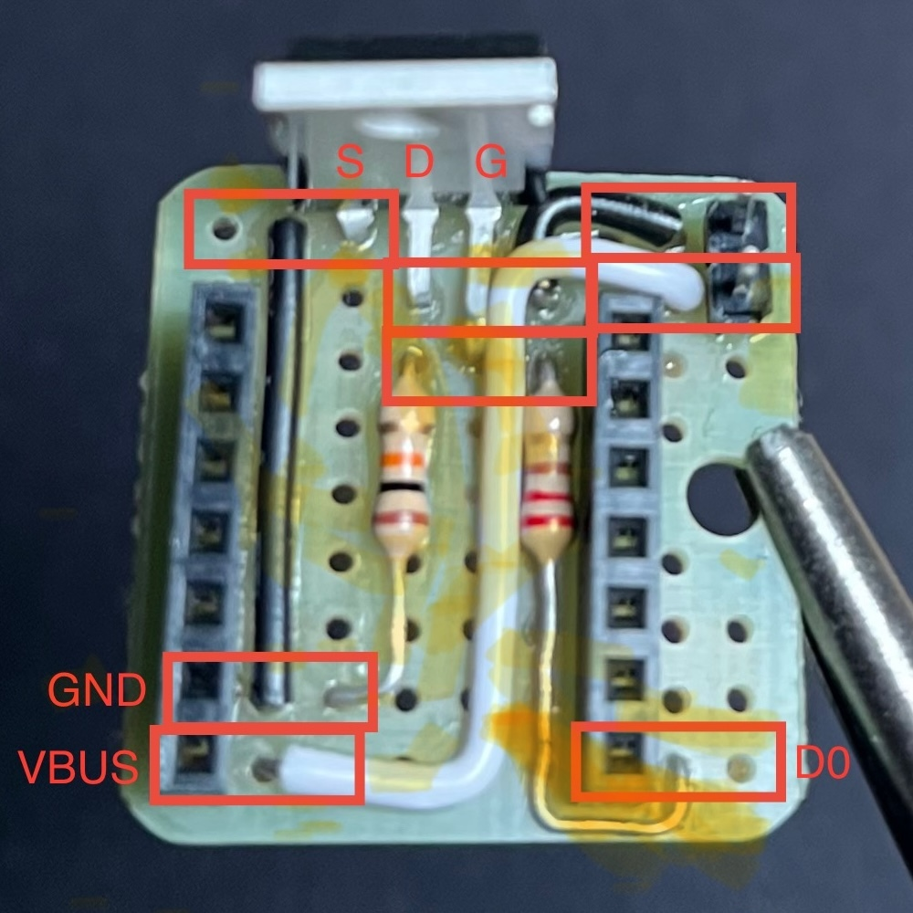

# Wiring

Physical build reference for both nodes: part numbers, pinouts, and
wiring for ordering and building one. See README.md for the
project-level "why" behind these choices and their history.

Both nodes use the same XIAO ESP32-C6 + Wio-SX1262 radio pair ("Shared
radio stack" below), each with the small flexible "ribbon" antenna
that ships with the Wio-SX1262. What differs is what's attached, how
each is powered, and what the modules mount on.

- **Transmitter** — outdoor, battery-powered: custom PCB, magnetic reed
  switch, 3x AA lithium primary cells through an LDO, in a waterproof
  enclosure.
- **Receiver** — indoor, USB-powered, always on: stacked modules on a
  1"x1" protoboard that also carries a MOSFET-switched held-open
  warning beacon.

## Shared radio stack

The Wio-SX1262 (the "for XIAO ESP32S3" through-hole-header variant) is
a HAT for the XIAO ESP32-C6 and fixes these pins on both nodes. rx
stacks it as a HAT; tx's PCB seats the two modules side by side
instead. The
pinout was read from the boards' silkscreen; see `lora_pins.h`:

| XIAO pin | GPIO | Radio signal |
|---|---|---|
| D1 | GPIO1 | DIO1 |
| D2 | GPIO2 | RST |
| D3 | GPIO21 | BUSY |
| D4 | GPIO22 | NSS |
| D5 | GPIO23 | RF_SW |
| D8 | GPIO19 | SCK |
| D9 | GPIO20 | MISO |
| D10 | GPIO18 | MOSI |

That leaves three header GPIOs, each with a catch:

- **D0 (GPIO0)** — the only free RTC-domain pin (deep-sleep wake
  capable), and not a C6 strapping pin. **The Wio HAT's own onboard
  user button (`K1`) and its 10kΩ pull-up (`R2`) are wired to this
  same `D0` net** — confirmed from Seeed's KiCad schematic, present as
  shipped. The button is unused in this project. Each node deals with
  it differently: tx's PCB leaves the Wio's D0 unconnected, and rx just
  leaves the button alone.
- **D6/D7 (GPIO16/17)** — UART0 TX/RX. The installed core's prebuilt
  ESP-IDF has its console on UART0 (`CONFIG_ESP_CONSOLE_UART_NUM=0` in
  `~/.arduino15/packages/esp32/tools/esp32c6-libs/3.3.11/sdkconfig`),
  regardless of a sketch's `CDCOnBoot` setting, and the Arduino board
  menu doesn't expose it. Confirmed unusable as a plain GPIO output on
  rx: the pin sat at ~3V whatever the firmware wrote. Not RTC-capable
  either.

## Transmitter

Outdoor node: magnetic reed switch, 3x AA lithium primary cells
through a nanopower LDO. **The current build is a custom PCB**
(`kicad/loragate_tht/`) in an IP65 enclosure, tested and working as
pictured. The
original Perma-Proto protoboard build is still documented below where
it differs.



### Pin table

All 14 XIAO header pins, one source of truth for tx:

| XIAO pin | GPIO | Use |
|---|---|---|
| D0 | GPIO0 | **Reed switch** (see below for why this pin specifically) |
| D1 | GPIO1 | LoRa DIO1 |
| D2 | GPIO2 | LoRa RST |
| D3 | GPIO21 | LoRa BUSY |
| D4 | GPIO22 | LoRa NSS |
| D5 | GPIO23 | LoRa RF_SW |
| D6 | GPIO16 | UART0 TX — broken out to the PCB's `J3` UART header for FTDI serial monitoring |
| D7 | GPIO17 | UART0 RX — same, `J3` |
| D8 | GPIO19 | LoRa SCK |
| D9 | GPIO20 | LoRa MISO |
| D10 | GPIO18 | LoRa MOSI |
| 3V3 | — | LDO regulated output (see "Power" below — not a direct battery connection) |
| GND | — | battery − / reed switch return / `J3` GND |
| VBUS/5V | — | unused (no USB power in the field) |

D1-D5 and D8-D10 are the radio (see "Shared radio stack" above). The
protoboard build planned I2C add-ons on D6/D7 instead; see "Future
additions" for why that plan conflicts with UART0.

### Mounting the modules

#### Custom PCB (current)





A 30.4 x 58.5mm through-hole PCB (exports above; `kicad/loragate_tht/`
is the source of truth, with gerbers in `gerbers/`). **The two modules
aren't stacked as a HAT.** Each gets its own 2x7 footprint: the XIAO
(`U2`) and the Wio-SX1262 (`U3`) sit end to end. The Wio is mounted
flipped on its back (footprint `XIAO_Module_Pin_Flipped_2x7`), which
mirrors its pinout and makes the trace routing easier. Down the side
are the power parts (`J1` battery connector, `F1` fuse, `C1`/`C2`, and
`U1` MCP1700), and along the bottom edge are `J3` (UART: D7-RX, D6-TX,
GND), `R1` (1MΩ pull-up), and `J2` (reed switch).

Only the radio signals and 3V3/GND are routed between the modules. The
Wio's `D0`, `D6`, `D7`, and `VIN` pins are left unconnected, and so is
the XIAO's `VBUS`. **Leaving the Wio's `D0` unconnected isolates the
reed switch from the HAT's onboard button and pull-up** (see "D0 and
the HAT's button" below) **without modifying either module from
stock.**

The 3D-printed mount (`mount/`) holds the PCB and the 3xAA holder side
by side and screws onto the enclosure's mounting posts.

#### Perma-Proto protoboard (original build)

The XIAO ESP32-C6 + Wio-SX1262 stack mounts on an
[Adafruit Perma-Proto Quarter-sized breadboard PCB](https://www.digikey.com/en/products/detail/adafruit-industries-llc/1608/5154676)
(1.7" x 2.0", breadboard-style bus strips — chosen over a bare 9x9-hole
protoboard for room to fit the LDO, resistor, caps, and JST-PH pads
alongside the stack's socket): female pin headers soldered onto the
protoboard as a socket, with the Wio module (male pins facing down)
plugging into it. 13 of the 14 XIAO signals (D1-D10, 3V3, GND, VBUS)
land as ordinary through-hole solder points on the protoboard's
underside. **D0 is the one exception** — it's bypassed around the
stack entirely rather than landing here normally; see "D0 and the
HAT's button" below for why. (`mount/`'s git history has the
protoboard-era version of the mount.)

### Reed switch

#### Why D0, not an arbitrary free pin

Waking from deep sleep on a GPIO edge requires an RTC-domain pin —
on the ESP32-C6, that's GPIO0-7 only. Of the three free header pins,
D0 (GPIO0) is the only one in that range; D6/D7 (GPIO16/17) aren't
RTC-capable, so they're only useful for something read while already
awake (like an RTC's I2C bus) — and they're UART0 besides (see "Shared
radio stack"). It's not a free choice — it's the only
option left once the radio has claimed D1/D2, the other two
RTC-capable pins.

GPIO0 is not a strapping/boot-select pin on the C6 (unlike classic
ESP32), so there's no boot hazard here — but see "D0 and the HAT's
button" below for a different hazard this pin choice runs into.

#### Reed switch circuit

Standard alarm-style reed switch: contacts closed (continuity) when
the magnet is present (gate closed), open when it moves away (gate
open). D0 needs a pull-up to read a clean HIGH when open.

**External 1MΩ resistor from D0 to 3V3, internal pull-ups explicitly
disabled in firmware.** An internal ~45kΩ pull-up would leak ~73µA
whenever the gate is closed unless firmware disables it before every
single sleep entry — a recurring hazard on any code path that reaches
`esp_deep_sleep_start()`, including future ones. The external 1MΩ
leaks ~3.3µA regardless of code path and can't regress. If the real
installation turns out electrically noisy (long cable run, near AC
wiring), drop to 100kΩ.

#### D0 and the HAT's button

The HAT's onboard button and 10kΩ pull-up sit on the reed switch's
`D0` net (see "Shared radio stack" above). With the door closed,
current flows through the parallel combination of that 10kΩ and the
external 1MΩ pull-up
(`3.3V / (1MΩ ∥ 10kΩ) ≈ 333µA` — matched a live measurement of ~318µA
closely; see README.md's power-budget History for the full
investigation).

**On the PCB:** the Wio's `D0` pin isn't connected to anything (see
"Custom PCB" above), so the problem can't occur.

**On the protoboard: snip `D0` out of the stacking header entirely,
bridge with a direct wire.** Both the XIAO's own `D0` pin and the Wio HAT's `D0` pin
are cut flush where each protrudes past its own board's solder joint
(the stub below the board, not through it) — each stacking pin is one
continuous piece of metal soldered to its own board where it passes
through, so cutting the protruding stub removes only the portion that
would otherwise reach the next board, without disturbing either
board's own solder joint or socket. A short wire is then soldered
directly from the XIAO's `D0` pin to the reed-switch circuit on the
protoboard, routed around the Wio HAT entirely. The HAT's button and
its pull-up are left connected to nothing but each other and `+3V3` —
isolated and harmless, since this project never uses that button.

Confirmed on the actual hardware with test jumper cables before
cutting anything: **21.9µA (door closed) / 18.5µA (door open)** with
the bypass, vs. the faulty ~318µA/closed-door signature with `D0`
wired through the HAT normally. (rx doesn't need any of this — see
"Receiver" → "Mounting the modules".)

### Power

**3x AA Energizer Ultimate Lithium (L91) cells in series, through an
LDO, into the XIAO's 3V3/GND header pins** — not the board's dedicated
BAT solder pads, and not a direct battery connection.

#### Why primary lithium, not rechargeable Li-ion/LiPo

The XIAO's onboard charge circuit (the BAT pads, below) makes
rechargeable Li-ion/LiPo the path of least resistance on this board,
so it's worth stating why this build avoids it. Deployment climate
here has no hard freezes, so L91's cold-weather edge doesn't matter —
but summers reach ~90°F ambient, and a sealed IP67 box in direct sun
runs hotter still inside, which is exactly where Li-ion/LiPo capacity
fade accelerates and pouch-cell failure modes (puncture, swelling,
thermal runaway) get worse with age. Primary cylindrical cells carry
none of those failure modes — matching the alarm industry's own
convention of primary lithium for door/window sensors.

#### Why not a direct battery connection

The XIAO's exposed **3V3 header pin is wired directly to the
ESP32-C6's VDD** — confirmed on a Seeed forum thread about this pin —
with no protection or regulation. The datasheet-recommended range is
3.0-3.6V; a fresh L91 cell sits close to 1.8V under light load, so two
fresh cells in series can be close to 3.6V right out of the pack —
zero margin on day one, before pack-to-pack or temperature variance.
The board's **BAT pads** aren't an alternative either — they're wired
to an onboard Li-ion/LiPo charge controller that will try to charge
whatever's connected there, and primary cells aren't rechargeable.

#### Short-circuit protection

**[Bourns MF-R050](https://www.digikey.com/en/products/detail/bourns-inc/MF-R050/259965)
(or TE/Raychem RXE050, dual-sourced equivalent), a resettable PTC
fuse, in series between the battery holder and the LDO's input** —
not on the regulated 3V3 output side. Radial leaded, 5.08mm/0.2" lead
spacing, drops into the Perma-Proto the same as everything else.

**Why needed at all, given both ends already protect themselves:**
each L91 cell has its own internal PTC plus a pressure-relief vent and
is independently rated to survive a direct external short; the LDO has
its own overcurrent/thermal shutdown on the output side. What neither
covers is the wiring, battery connector, and battery holder's spring
contacts in between — none of which carry a comparable rating.

**Why MF-R050 specifically:** sized against the LDO's own rated
maximum continuous current (250mA, not this firmware's current
~125mA TX draw, so a future firmware change doesn't turn the fuse into
an unintended bottleneck), derated for a 60°C worst-case ambient (same
ceiling the L91 cells are rated to):

| Part | Ihold @23°C | Ihold @60°C (derated) | Margin over 250mA floor |
|---|---|---|---|
| MF-R030 | 300mA | 190mA | under the floor |
| MF-R040 | 400mA | 250mA | zero margin |
| **MF-R050 (chosen)** | 500mA | 320mA | **+70mA** |

MF-R050 also has *less* resistance than the smaller parts in this
family (0.77Ω max), adding only ~0.10V drop at our actual ~125mA TX
current.

**Trip time for a real short:** three L91 cells (~0.3Ω pulse
resistance) plus the fuse (0.41-0.77Ω) plus wiring (~0.15Ω) gives
roughly 1.0Ω total loop resistance — at a fresh pack's ~5.4V, an
estimated ~5A short-circuit current, comfortably above MF-R050's 2.5A
qualification current (guaranteed to trip within 4.0s at that point,
worst case; real trip time at ~5A is faster, though not quantified
beyond that spec figure).

#### Choosing an LDO

Fixed 3.3V output, needs to accept the pack's full discharge range
without exceeding its own input ceiling. 3 cells (not 2) puts the
fresh-pack voltage (~5.1-5.4V) safely under either candidate's 6.0V
input ceiling with room to spare — at no mAh cost, since a linear
regulator draws roughly the same current from its input as it
delivers at its output regardless of input voltage.

##### MCP1700 (Microchip, TO-92) — installed

[Microchip MCP1700](https://ww1.microchip.com/downloads/aemDocuments/documents/APID/ProductDocuments/DataSheets/MCP1700-Data-Sheet-20001826F.pdf),
3.3V fixed output (`MCP1700-3302E/TO`, TO-92) — 1.6µA typical / 4µA
max quiescent current, 2.3-6.0V input range, 150mV typical dropout
@200mA. Bare 3-terminal part (GND, VIN, VOUT), no enable pin, no
SOT-to-DIP adapter needed — legs bent to the standard 0.1" grid, drops
straight into the Perma-Proto.

**Package orientation** (confirmed against the datasheet's mechanical
drawing, cross-checked against an independent pinout source): holding
the part with its flat, marked face toward you and legs pointing down,
pins left to right are **GND, VIN, VOUT**.

| MCP1700 pin (TO-92, flat face toward viewer) | Connects to |
|---|---|
| 1 (GND, leftmost) | battery − / system GND |
| 2 (VIN, middle) | battery + (through the battery disconnect, below) |
| 3 (VOUT, rightmost) | XIAO 3V3 pin |

Needs a ~1µF capacitor on **both** VIN-GND and VOUT-GND — the
datasheet treats the input cap as required for stability here, not
just good practice. Ceramic, tantalum, or aluminum electrolytic are
all acceptable; 1µF X7R ceramics are what's installed.

##### TPS7A0233 (TI) — alternative, lower quiescent current

[TI TPS7A02](https://www.ti.com/lit/ds/symlink/tps7a02.pdf), 3.3V
fixed output (suffix `33`), SOT23-5 — 25nA quiescent current even in
dropout, 60-160x lower than the MCP1700's. The true-nanopower pick,
worth revisiting if squeezing out that last bit of sleep-current
budget ever matters; a bench unit was built but tested dead (0V
output, bad part or solder joint, not a design issue) and wasn't
retried. Needs its own build path since no breakout exists for this
chip: a bare `TPS7A0233PDBVR` hand-soldered onto a
[Proto Advantage/Chip Quik PA0086C](https://www.digikey.com/en/products/detail/chip-quik-inc/PA0086C/12352102)
SOT23-5-to-DIP-6 adapter (0.1" pitch, drops into any protoboard).

| TPS7A02 pin | Connects to |
|---|---|
| 1 (IN) | battery + (through the battery disconnect, below) |
| 2 (GND) | battery − / system GND |
| 3 (EN) | tied to pin 1 (IN) — EN defaults *off* if left floating |
| 4 (NC) | unconnected |
| 5 (OUT) | XIAO 3V3 pin |

Needs a ~1µF ceramic (low-ESR, X7R/X5R/C0G — the datasheet is
compensated for ceramic specifically) on both IN-GND and OUT-GND.

#### Battery disconnect

**A 2-pin Molex KK-254-style disconnect (2.54mm pitch) between the
battery pack and the LDO's input** (`J1` on the PCB), always removed
before connecting USB. Parts come from a generic KF2510 kit. JST-PH
2.0mm (used on the protoboard build) was abandoned because its
crimp pins aren't practical to crimp at home; KK-254-style pins are
straightforward. The LDO means a
backfeed is two regulated 3.3V sources contending on one node rather
than raw battery voltage hitting VDD directly — safer, but still not
a scenario to rely on rather than avoid.

**Adding the LDO costs the onboard battery gauge, though** — `A1`/
`VBAT` reads the regulated 3.3V output after the LDO, not the raw
battery voltage, so it stays flat for most of the pack's life. See
"Future additions" below for the fix.

### Enclosure and cable routing

Current build (photo at the top of this section):

- IP65 hinged-lid enclosure. The PCB and battery holder sit on the
  3D-printed mount, and the only penetration is a cable gland on the
  bottom face for the reed-switch lead.
- **Antenna: the Wio-SX1262's stock ribbon antenna, inside the
  enclosure**, on the module's U.FL connector. Range turned out to be
  good enough with it (see README.md's Hardware history), and it takes
  up almost no room.
- 22/2 white UV-rated cable to the reed switch, joined with adhesive
  solder-seal heat-shrink sleeves.
- Reed switch: Interlogix 1085W-N or Honeywell 7945WH, fully potted,
  1.5" gap — wide gap resists false triggers from gate rattle/wind.
- Cable secured to the gate's lowest rail with GE Silicone II dabs
  every 12-18", or outdoor acrylic tape — both removable without
  damaging paint/powder coat.

Original plan, for the protoboard build:

- IP67 ABS junction box, ~125 x 75 x 75mm, all penetrations on the
  bottom face: SMA bulkhead and a PG7 cable gland for the sensor lead.
- Antenna chain (bought, but not used: the stock ribbon antenna was
  enough): Wio-SX1262's onboard U.FL connector →
  [U.FL-to-SMA-bulkhead pigtail](https://www.digikey.com/en/products/detail/rf-solutions/CBA-UFLSMA-1/5845754) →
  enclosure's bottom face →
  [915MHz SMA whip antenna](https://www.digikey.com/en/products/detail/nearson-inc/S463AM-915/4571855),
  pointing straight down (keeps the connector shielded from pooling
  water, radiation pattern horizontal). The antenna has no stated
  weatherproof rating of its own; pointing down and relying on the
  bulkhead's O-ring is the mitigation.

### Future additions

**Caveat for both additions below: they were planned for the protoboard
build, on an I2C bus on D6/D7.** D6/D7 are UART0 (see "Shared radio
stack"): ESP-IDF's console claims them regardless of `CDCOnBoot`, and
the current PCB dedicates them to the `J3` FTDI header for tx's
production serial monitoring. The same UART0 claim kept rx's beacon
from working on D6. Revisit the pin choice (and the PCB) before
building either one.

#### Battery voltage monitoring

Not yet wired into firmware. The ESP32-C6's own ADC can't be used for
this: of its three header-exposed ADC1 pins (`A0`/`A1`/`A2` =
D0/D1/D2), D0 is the reed switch and D1/D2 are wired point-to-point to
the radio's DIO1/RST — none free.

**Plan: a small I2C ADC on the D6/D7 bus instead**, reading a raw
battery-voltage divider tapped before the LDO. **ADS1115** (TI,
16-bit, I2C) — its single-shot mode auto-drops to ~0.5µA between
conversions, and its power-on-reset default is already that
power-down/single-shot mode, so misconfigured firmware still leaves
it idle rather than free-running. (An 18-bit MCP3421 was considered
first but its 2.25MΩ input impedance loads down a multi-MΩ divider
enough to need firmware workarounds; the ADS1115's impedance at
±4.096V full scale — the setting to use — doesn't.)

Divider: raw battery+ (tapped before the LDO) through 4.7MΩ to a tap
node, then 2.2MΩ from that node to GND; tap feeds AIN0. Adds roughly
~1.3µA worst-case to the sleep budget (divider + chip's own power-down
draw).

| ADS1115 pin | Connects to |
|---|---|
| VDD | XIAO 3V3 (regulated rail) |
| GND | system GND |
| SCL | D7/GPIO17 |
| SDA | D6/GPIO16 |
| ADDR | GND (I2C address 0x48) |
| AIN0 | raw-battery divider tap |
| AIN1 | GND (single-ended) |

**Sourcing:** the common "HW-543"-silkscreened ADS1115/ADS1015
breakout (widely resold, cheap, ships fast) works — confirmed no power
LED and no onboard regulator on the one checked, but since it's an
unbranded design, check the schematic printed on whatever specific
listing you buy from. [Adafruit #1085](https://www.adafruit.com/product/1085)
is the documented, slower-shipping fallback if that can't be
confirmed.

#### DS3231 RTC

Opportunistic addition on D6/D7 (I2C), lower priority than everything
else here — receiver receipt time is probably close enough for door
events, so this is only worth adding if it stays this cheap.

**Don't use a stock DS3231 breakout as-is** — the common ~$2 modules
include an onboard CR2032 trickle-charge circuit and power LED that
would eat into the sleep budget. Use a bare DS3231(M) directly, or a
breakout confirmed to have the charge resistor and LED removed.

### Bill of materials

| Part | Qty | Notes |
|---|---|---|
| XIAO ESP32-C6 | 1 | |
| Wio-SX1262 (for XIAO ESP32S3, through-hole variant) | 1 | |
| Custom PCB (`kicad/loragate_tht/`) | 1 | **current build** — see "Mounting the modules" |
| Adafruit Perma-Proto Quarter-sized breadboard PCB | 1 | **original build only** |
| 2x7 female pin headers, 2.54mm pitch | 1 pair | |
| Wio-SX1262 stock ribbon antenna (U.FL) | 1 | ships with the Wio-SX1262; **in use** |
| Interlogix 1085W-N or Honeywell 7945WH reed switch | 1 | |
| 3x AA Energizer Ultimate Lithium (L91) | 1 pack | |
| [Keystone Electronics 2465](https://www.digikey.com/en/products/detail/keystone-electronics/2465/303814) 3xAA holder | 1 | series-wired (4.5V), 6" bare leads, chassis mount, no cover |
| MCP1700-3302E/TO (Microchip, TO-92, 3.3V fixed LDO) | 1 | **installed** — see "Power" → "Choosing an LDO" |
| Through-hole ceramic capacitor, ~1µF ("105") | 2 | VIN and VOUT bypass — see "Power" |
| TPS7A0233PDBVR (TI, SOT23-5, 3.3V fixed LDO) | 1 | **alternative, not installed** — see "Power" → "Choosing an LDO" |
| Proto Advantage / Chip Quik PA0086C SOT23-5-to-DIP-6 adapter | 1 | TPS7A0233 only |
| Through-hole ceramic capacitor, ~1µF, low-ESR | 2 | TPS7A0233 only |
| Molex KK-254-style 2-pin header + crimp housing (generic KF2510 kit) | 1 | battery disconnect (`J1`) — see "Power" → "Battery disconnect" |
| 1x2 and 1x3 2.54mm pin headers | 1 each | PCB `J2` (reed switch) and `J3` (UART) |
| JST-PH 2.0mm 2-pin connector pair | 1 | **abandoned** (original build only) — pre-crimped, inline-soldered; replaced by KK-254 |
| [Bourns MF-R050](https://www.digikey.com/en/products/detail/bourns-inc/MF-R050/259965) (or TE/Raychem RXE050) resettable PTC fuse | 1 | battery-to-LDO short-circuit protection — see "Power" → "Short-circuit protection" |
| 1MΩ resistor | 1 | reed-switch pull-up |
| IP65 hinged-lid enclosure | 1 | **current build** |
| IP67 ABS junction box, ~125x75x75mm | 1 | original plan |
| [RF Solutions CBA-UFLSMA-1](https://www.digikey.com/en/products/detail/rf-solutions/CBA-UFLSMA-1/5845754) U.FL-to-SMA bulkhead pigtail | 1 | **bought, not used** — stock ribbon antenna was enough |
| [Nearson S463AM-915](https://www.digikey.com/en/products/detail/nearson-inc/S463AM-915/4571855) 915MHz SMA antenna | 1 | **bought, not used** — standard SMA male |
| Cable gland (PG7 in the original plan) | 1 | reed-switch lead |
| 22/2 white UV cable | as needed | ~50ft roll |
| Solder-seal heat-shrink sleeves | a few | splice to switch pigtail |
| ADS1115 I2C ADC — "HW-543"-style breakout or [Adafruit #1085](https://www.adafruit.com/product/1085) | 1 | **future addition** — see "Future additions" → "Battery voltage monitoring" |
| 4.7MΩ resistor | 1 | **future addition** — raw-battery divider, top half |
| 2.2MΩ resistor | 1 | **future addition** — raw-battery divider, bottom half |
| DS3231(M) RTC, bare chip or de-modded breakout | 1 | **future addition**, optional |

## Receiver

Indoor node: USB-powered, always on, on WiFi. Its only peripheral is a
held-open warning beacon, whose circuit is on the same 1"x1" protoboard
the radio stack plugs into. Tested and working as pictured.



### Pin table

All 14 XIAO header pins, one source of truth for rx:

| XIAO pin | GPIO | Use |
|---|---|---|
| D0 | GPIO0 | **Beacon switch** — drives the MOSFET gate (see "Held-open beacon" below) |
| D1 | GPIO1 | LoRa DIO1 |
| D2 | GPIO2 | LoRa RST |
| D3 | GPIO21 | LoRa BUSY |
| D4 | GPIO22 | LoRa NSS |
| D5 | GPIO23 | LoRa RF_SW |
| D6 | GPIO16 | unused — UART0 TX, not usable as GPIO (see "Shared radio stack") |
| D7 | GPIO17 | unused — UART0 RX, same |
| D8 | GPIO19 | LoRa SCK |
| D9 | GPIO20 | LoRa MISO |
| D10 | GPIO18 | LoRa MOSI |
| 3V3 | — | unused externally |
| GND | — | beacon circuit GND (MOSFET source, gate pull-down) |
| VBUS/5V | — | beacon +5V (USB-C power passes straight through) |

### Mounting the modules

A 1"x1", 9x9-hole protoboard, pads grouped in sets of 3 per row (each
row splits into three independent 3-hole islands: columns A-C, D-F,
G-I, with no bussing across groups or between rows). A mounting hole
knocks out pads on the right side. **The board is a dual 7-pin
socket**: two 1x7 female headers (columns A and G, rows 3-9) take the
Wio-SX1262's downward-facing male pins. The Wio is a HAT (female on
top, male below), so the XIAO's own two 7-pin male headers plug into
the top of the Wio, the usual stack. The beacon circuit fills the
space between the socket rows and along the top edge.

Unlike tx, **D0 isn't isolated from the HAT**: rx is mains-powered and
never sleeps, so the HAT button's µA-scale pull-up current doesn't
matter. Because rx *drives* D0, there's a different hazard: **don't
press the HAT's button.** While the GPIO drives HIGH, pressing it
shorts the output to GND. The button does nothing in this design. Tape
over it, or snip the D0 pin out of the stack the way tx's protoboard
build did (tx's "D0 and the HAT's button"). Driving LOW against `R2` is
only a ~330µA sink load, which is fine.

### Held-open beacon

A small rotating beacon light, on while the gate is reported held open
(firmware: `beacon_should_be_on()` in `rx/rx.ino`).

#### Circuit

Low-side switch: the GPIO can't drive the beacon's 5V/current directly,
so it switches a MOSFET in the beacon's **ground** return — easy to
drive from a 3.3V pin, and the GPIO never sees the beacon's own voltage.

```
VBUS (5V) ──────────────────────────────────┬── beacon +5V
                                              │
                                         [beacon]
                                              │
                                         beacon GND ── MOSFET drain
                                                         │
GPIO D0 ──[220Ω]── MOSFET gate                     MOSFET source ── GND
                       │
                     [10kΩ]
                       │
                      GND
```

- **VBUS** for power — the XIAO's raw USB 5V pass-through. The beacon
  draws ~20mA avg / ~25mA peak, well within a USB adapter's budget.
- **10kΩ pull-down** on the gate keeps the beacon off during the brief
  window after reset before `pinMode()`/`digitalWrite()` run.
- **No flyback diode** — the beacon is LED-only, no inductive load (see
  "Measured" below).
- **Third wire (mode-select)** left disconnected: floating gives the
  default rotating pattern, which is what this design wants. The board
  has only a 2-pin output header (no free slot for a third), so the
  beacon connector's PWM position hangs unconnected. See "Future
  additions" for driving it instead.

**Alternative to the MOSFET**: a 2N2222A/PN2222A (TO-92 NPN), with the
220Ω gate resistor swapped for a ~470Ω base resistor — fine for a load
this size, and maybe more likely to be on hand. 470Ω leaves comfortable
margin at a conservative hFE; 2.2-4.7kΩ would work too.

#### Measured

Measured with a Nordic PPK2 (`/var/tmp/beacon_current.png`, a brief
pulse and a multi-second run — same pattern):

- **~20mA average, ~25mA peak, no inrush.** A ~250ms ~7mA trough at
  turn-on (driver IC power-on sequencing), then a step-like waveform with
  no ringing or decay — an LED ring strobed to fake rotation, not a
  motor. Visually confirmed LED-only too.
- So: no flyback diode needed, and no VBUS headroom concern.
- The beacon's factory connector is a standard 1x3 2.54mm DuPont-style
  female header, wired **black / white / grey = GND / +5V / PWM**.

#### Protoboard wiring (as built)

Islands used, as boxed in red in the photo above (rows numbered from
the top, socket pin rows 3-9):

| Island | Net | Connections |
|---|---|---|
| Row 1, A-C | GND | MOSFET source; black jumper down to row 8 |
| Row 2, D-F | Drain (beacon's switched GND) | MOSFET drain; black wire to the output header's row-1 pin |
| Row 3, D-F | Gate | MOSFET gate; 10kΩ down to row 8 (GND); 220Ω down to row 9 (D0) |
| Row 1, G-I | Beacon GND | output header pin; black wire from the drain |
| Row 2, G-I | Beacon +5V | output header pin; white wire from row 9 (VBUS) |
| Row 8, A-C | GND | socket pin (GND); black jumper from the source; 10kΩ |
| Row 9, A-C | VBUS | socket pin (VBUS); white wire up to row 2, G-I |
| Row 9, G-I | D0 | socket pin (D0); 220Ω |

**The output header's "GND" pin is the MOSFET drain, not the board's
GND rail**: that's the switched node. Wired straight to GND, the
beacon would be permanently on.

The beacon's connector plugs on with black (GND) on the row-1 pin
(drain), white (+5V) on the row-2 pin (VBUS), and grey (PWM) hanging
off the end. DuPont pin order isn't standardized across RC-accessory
vendors, so check the wire colors on any replacement beacon.

**The MOSFET's legs are bent so each lands in a different row's
island** (source row 1, drain row 2, gate row 3), and the body is
folded up off the board's top edge. That way the whole unit fits in an
enclosure only slightly larger than the 1"x1" board.

### Power

USB-C into the XIAO. VBUS (the raw 5V pass-through)
also feeds the beacon, at ~25mA peak.

### Future additions

#### Beacon mode-select from software

Not needed (floating gives the default pattern) and not planned, but
easy if ever wanted.

**Pin: not settled.** D6/D7 are UART0 (see "Shared radio stack") and D0
is taken by the on/off switch, so there's no obviously free pin left on
the 14-pin header. Needs fresh investigation if pursued; the approach
below still holds.

**Wiring**: beacon signal wire straight to the GPIO — it's a logic-level
input on the beacon's driver board, no transistor needed. A 220-470Ω
series resistor is cheap insurance.

**Signal**: standard RC servo/ESC-style PWM — 50Hz (20ms period), a
1000-2000µs pulse width selecting the mode. There's no published
mapping for this unit, so build a mode table empirically: hold each
pulse width for a second or two across that range in ~50-100µs steps
and note what pattern plays.

**Firmware**: the ESP32-C6's LEDC peripheral generates this in
hardware once configured:

```cpp
#define BEACON_MODE_PIN      /* TBD — see "Pin: not settled" above */
#define BEACON_PWM_FREQ_HZ   50
#define BEACON_PWM_BITS      16     // plenty of duty-cycle resolution

void setup() {
  ledcAttach(BEACON_MODE_PIN, BEACON_PWM_FREQ_HZ, BEACON_PWM_BITS);
  set_beacon_mode_us(1500);  // pick a starting pulse width once mapped
}

// pulse_us: the pulse width (microseconds) to hold, out of a 20ms
// (50Hz) period — set once and left running, not called every loop().
void set_beacon_mode_us(uint32_t pulse_us) {
  const uint32_t period_us = 1000000UL / BEACON_PWM_FREQ_HZ;
  const uint32_t max_duty = (1UL << BEACON_PWM_BITS) - 1;
  uint32_t duty = (uint64_t)pulse_us * max_duty / period_us;
  ledcWrite(BEACON_MODE_PIN, duty);
}
```

(`ledcAttach`/`ledcWrite` is the Arduino-ESP32 core 3.x API — older
examples use `ledcSetup`/`ledcAttachPin`, which this core no longer
has.) This is independent of the D0 power switch; the PWM can keep
running while the beacon is unpowered.

### Bill of materials

| Part | Qty | Notes |
|---|---|---|
| XIAO ESP32-C6 | 1 | |
| Wio-SX1262 (for XIAO ESP32S3, through-hole variant) | 1 | |
| RC-style LED rotating beacon, 5V, 3-wire (+5V / GND / PWM mode-select) | 1 | ~20-25mA — see "Measured" |
| 1"x1" 9x9-hole protoboard, 3-pad islands per row | 1 | stack socket + beacon circuit — see "Mounting the modules" |
| 1x7 female pin header, 2.54mm | 2 | socket for the Wio-SX1262's male pins |
| Wio-SX1262 stock ribbon antenna (U.FL) | 1 | ships with the Wio-SX1262 |
| IRLZ44N (TO-220, logic-level N-channel MOSFET) | 1 | Vgs(th) ~1-2V, switches well under 3.3V drive — overkill for ~20-25mA, but standard, cheap, always in stock. 2N2222A/PN2222A is an alternative (see "Circuit") |
| 220Ω resistor | 1 | MOSFET gate series resistor |
| 10kΩ resistor | 1 | gate pull-down |
| 1x2 0.1"/2.54mm male pin header | 1 | beacon output — the beacon's 1x3 factory connector plugs on with its grey PWM position hanging free |
| Hookup wire | short lengths | jumpers (black for GND/drain, white for VBUS) |
